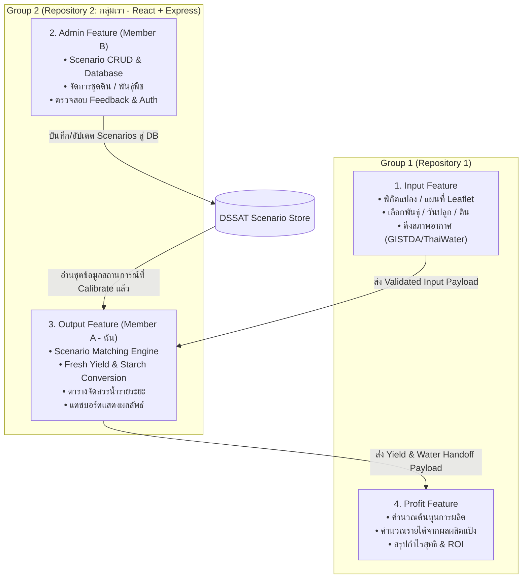
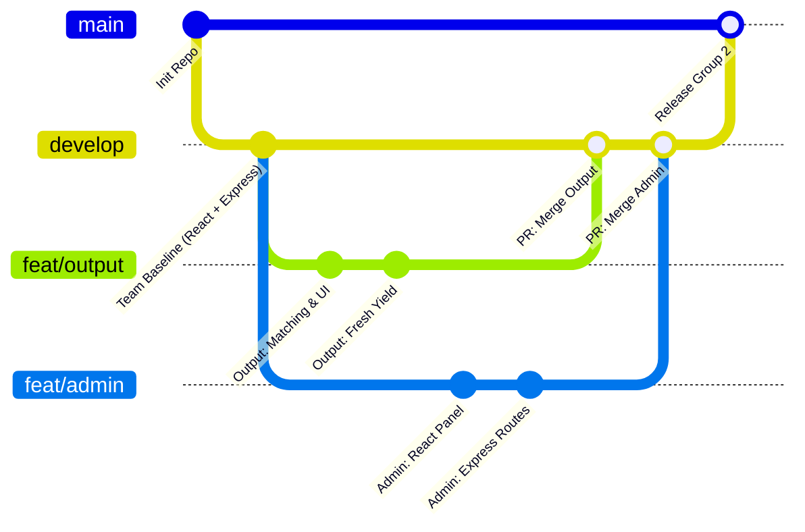

# WarMa: Water Resources Management Advisor
# เอกสารข้อเสนอโครงสร้างโฟลเดอร์สำหรับโมดูล Output และ Admin (Folder Structure Proposal)

> **เอกสารสำหรับการหารือและตกลงร่วมกันระหว่าง 2 กลุ่ม (Architecture Discussion & Baseline Specification)**  
> **กลุ่มที่รับผิดชอบ:** กลุ่มย่อยที่ 2 (Group 2: Output & Admin)  
> **สมาชิกในกลุ่ม:**  
> - **Member A (Output - ฉัน):** นายดุลยเดช พวงจำปี (รหัสนักศึกษา 673040387-9)  
> - **Member B (Admin):** นายศิรัชวิทค์ พิมพะกรรณ์ (รหัสนักศึกษา 673040130-6)  
> **มาตรฐาน Tech Stack:** **React (Frontend) + Express (Backend) แยกกันอิสระตามมาตรฐานของฉัน**  
> **สถานะเอกสาร:** ข้อเสนอโครงสร้างระบบและสถาปัตยกรรมข้อมูล (Proposed Architecture for Review)  
> **วันที่ปรับปรุง:** 1 พฤศจิกายน 2026  

---

## สารบัญ (Table of Contents)

1. [ภาพรวมโครงการและบริบททีมงาน (Project Overview)](#1-ภาพรวมโครงการและบริบททีมงาน-project-overview)
2. [มาตรฐาน Tech Stack: React + Express แยกกันเด็ดขาด (Core Tech Stack Principles)](#2-มาตรฐาน-tech-stack-react--express-แยกกันเด็ดขาด-core-tech-stack-principles)
3. [การวิเคราะห์สถาปัตยกรรมและโค้ดปัจจุบัน (Existing Architecture Analysis)](#3-การวิเคราะห์สถาปัตยกรรมและโค้ดปัจจุบัน-existing-architecture-analysis)
4. [ความสัมพันธ์ระหว่าง 4 ฟีเจอร์หลัก (Relationship Between the 4 Features)](#4-ความสัมพันธ์ระหว่าง-4-ฟีเจอร์หลัก-relationship-between-the-4-features)
5. [ทางเลือกสถาปัตยกรรมการจัดเก็บข้อมูลแบบจำลอง (Data Storage Architecture Options)](#5-ทางเลือกสถาปัตยกรรมการจัดเก็บข้อมูลแบบจำลอง-data-storage-architecture-options)
6. [ข้อเสนอโครงสร้างโฟลเดอร์ Output & Admin (Proposed Folder Structure)](#6-ข้อเสนอโครงสร้างโฟลเดอร์-output--admin-proposed-folder-structure)
7. [คำอธิบายหน้าที่และความรับผิดชอบของแต่ละโฟลเดอร์ (Folder Responsibilities)](#7-คำอธิบายหน้าที่และความรับผิดชอบของแต่ละโฟลเดอร์-folder-responsibilities)
8. [การแบ่งความเป็นเจ้าของและการจัดการโค้ด (Member Ownership & Boundaries)](#8-การแบ่งความเป็นเจ้าของและการจัดการโค้ด-member-ownership--boundaries)
9. [คอมโพเนนต์ส่วนกลางและ Data Contracts (Shared Components & Contracts)](#9-คอมโพเนนต์ส่วนกลางและ-data-contracts-shared-components--contracts)
10. [กลยุทธ์การบริหาร Git (Git Branching & Workflow Strategy)](#10-กลยุทธ์การบริหาร-git-git-branching--workflow-strategy)
11. [แนวทางการเชื่อมต่อกับ Input และ Profit (Integration with Input & Profit)](#11-แนวทางการเชื่อมต่อกับ-input-และ-profit-integration-with-input--profit)
12. [จุดเสี่ยง Merge Conflict และแนวทางป้องกัน (Potential Merge Conflicts & Mitigation)](#12-จุดเสี่ยง-merge-conflict-และแนวทางป้องกัน-potential-merge-conflicts--mitigation)
13. [ประเด็นคำถามที่ต้องตกลงร่วมกันของทีม (Questions Requiring Team Agreement)](#13-ประเด็นคำถามที่ต้องตกลงร่วมกันของทีม-questions-requiring-team-agreement)

---

## 1. ภาพรวมโครงการและบริบททีมงาน (Project Overview)

### 1.1 ที่มาและวัตถุประสงค์โครงการ
โครงการ **WarMa (Water Resources Management Advisor)** เป็นเว็บแอปพลิเคชันสำหรับเกษตรกรและบุคคลทั่วไปในการวางแผนและตัดสินใจจัดการน้ำสำหรับการปลูก **มันสำปะหลัง (Cassava)** ในพื้นที่ภาคตะวันออกเฉียงเหนือ (ขอนแก่นและอุดรธานี) โดยดึงข้อมูลจำลองการเติบโตของพืชจากแบบจำลองระดับโลก **DSSAT (Decision Support System for Agrotechnology Transfer)** ซึ่งเดิมมีความซับซ้อน นำมาจับคู่กับสถานการณ์จำลองล่วงหน้า (Predefined Scenarios) และแปลงผลลัพธ์จากน้ำหนักแห้งเป็น **น้ำหนักสด (Fresh Weight: ตัน/ไร่)** พร้อมตารางการให้น้ำที่ปฏิบัติได้จริง

### 1.2 โครงสร้างทีมงานและการแบ่งงาน 4 คน 2 กลุ่ม
ตามข้อกำหนดรายวิชา EN813701 โครงการพัฒนาโดยทีมงาน 4 คน แบ่งเป็น 2 กลุ่มย่อย และแต่ละกลุ่มดูแล Git Repository แยกกัน โดยทุกคนต้องมีบทบาทพัฒนาแบบ **Full-Stack (ทั้ง Frontend และ Backend)**:

| กลุ่ม (Group) | สมาชิก | ฟีเจอร์ที่รับผิดชอบ | หน้าที่และความรับผิดชอบหลัก |
|---|---|---|---|
| **Group 1** | Member 1, Member 2 | **Input, Profit** | ระบบรับข้อมูลแปลง พิกัด แผนที่ ดึงข้อมูลสภาพอากาศ และระบบคำนวณต้นทุน/กำไรทางเศรษฐศาสตร์ |
| **Group 2 (กลุ่มเรา)** | **Member A, Member B** | **Output, Admin** | **ระบบจับคู่ประมวลผลผลลัพธ์ แสดงคำแนะนำตารางน้ำ และระบบจัดการข้อมูลสถานการณ์หลังบ้าน** |

ภายใน **Group 2** แบ่งงานอย่างเป็นอิสระ:
- **Member A (Output - ฉัน):** รับผิดชอบโมดูล Output แบบ Full-Stack (Matching Engine, Yield Conversion, Dashboard UI) บน React + Express
- **Member B (Admin):** รับผิดชอบโมดูล Admin แบบ Full-Stack (Scenario CRUD, Data Store Management, Admin Panel UI, Auth) บน React + Express

---

## 2. มาตรฐาน Tech Stack: React + Express แยกกันเด็ดขาด (Core Tech Stack Principles)

เพื่อตัดความสับสนและไม่ให้เกิดความซับซ้อนเกินจำเป็น โครงการนี้กำหนดมาตรฐานทางเทคโนโลยีตามแนวทางของฉันอย่างเด็ดขาด:

> [!IMPORTANT]
> **ข้อตกลงหลักด้าน Tech Stack (Strict Requirement):**
> 1. **Frontend:** **Pure React SPA** (ใช้ Vite + Tailwind CSS v4) ทำงานอยู่ที่พอร์ต `3000` (หรือ `5173`)
> 2. **Backend:** **Pure Node.js + Express.js (TypeScript)** ให้บริการ RESTful API อยู่ที่พอร์ต `5000`
> 3. **แยกกันอิสระ (Completely Decoupled):** โฟลเดอร์ `frontend/` และ `backend/` แยก `package.json` ของตนเอง ตัดขาด Dependency ออกจากกันอย่างสมบูรณ์ สื่อสารกันผ่าน HTTP REST API (JSON) เท่านั้น
> 4. **ไม่ใช้ Next.js และไม่ใช้ NestJS:** โค้ด Prototype ฝั่ง Next.js / NestJS ใน Branch `develop` จะต้องถูก Migrate มาเป็น React Component และ Express Router/Controller ปกติเท่านั้น
> 5. **หลีกเลี่ยง Monorepo Tooling ซับซ้อน:** ใช้สคริปต์ Node ธรรมดา (`scripts/dev.js` ผ่าน `npm run dev`) ในการสตาร์ตทั้งสองฝั่ง ไม่ใช้ Lerna, Turborepo หรือ Git Submodule

---

## 3. การวิเคราะห์สถาปัตยกรรมและโค้ดปัจจุบัน (Existing Architecture Analysis)

จากการตรวจสอบโครงสร้างโปรเจกต์ โค้ดต้นฉบับ ประวัติ Git และเอกสารข้อกำหนด (`docs/doc.md`, `docs/todo.md`, `RUN.md`) พบข้อมูลเชิงสถาปัตยกรรมดังนี้:

### 3.1 สถานะปัจจุบันใน Git Repository (`Wab-App---WarMa`)
โปรเจกต์มีการแยก Branch พัฒนาที่สำคัญ 2 เส้นทาง:

1. **Branch `output-dev` (งานของ Member A - ฉัน):**
   - พัฒนาบน Stack มาตรฐาน: **Vite + React 19 + Tailwind CSS v4** และ **Express.js + TypeScript**
   - **Backend (`backend/src/`):**
     * `index.ts`: Entry point เซิร์ฟเวอร์ Express (Port 5000), มี CORS, Health Check (`GET /api/health`), Route mount (`/api/output`)
     * `modules/output/`: แยกโฟลเดอร์สำหรับ Output ชัดเจน ประกอบด้วย controllers, services, routes, types
     * `shared/`: เก็บ contracts, store, middlewares กลาง
     * ผ่านการทดสอบ Endpoint `POST /api/output/match` และ Health Check เรียบร้อย
   - **Frontend (`frontend/src/`):**
     * `App.tsx`: Navigation แบบ State (`/input`, `/output`, `/output-v1`), การยิง API `handleCalculate`, การเชื่อมโยง Modal
     * `features/output/`: รวบรวม components (`YieldSummaryCard`, `WaterScheduleTable`, `ScenarioComparison`, `VarietyGuideModal`), pages (`OutputPage`, `OutputV1Page`), services, และ hooks
     * `features/input-mock/`: รวบรวมหน้าจอและ Component สำหรับยิงทดสอบระบบ
     * `shared/`: คอมโพเนนต์ส่วนกลาง (Header, Footer, Loading, Alert)

2. **Branch `develop` (งาน Prototype เดิมของ Member B - Admin):**
   - สร้างขึ้นเป็น Prototype ด้วย Next.js และ NestJS + Prisma
   - มี Component และ Service ของ Admin ที่เตรียมไว้แล้ว เช่น `AdminPanel.tsx`, `ScenarioEditor.tsx`, `FeedbackPanel.tsx`, `admin.guard.ts`, `scenarios.service.ts`
   - **แนวทางปฏิบัติ:** ย้ายเฉพาะ UI Logic และ Business Logic ของ Admin จาก Prototype เข้าสู่สถาปัตยกรรม **Pure React** (`frontend/src/features/admin/`) และ **Express Router/Controller** (`backend/src/modules/admin/`) ให้ตรงกับ Stack ของฉัน

---

## 4. ความสัมพันธ์ระหว่าง 4 ฟีเจอร์หลัก (Relationship Between the 4 Features)

การทำงานของระบบ WarMa เกิดจากการร้อยเรียง 4 โมดูลหลักเข้าด้วยกันแบบท่อส่งข้อมูล (Data Pipeline):



### รายละเอียดการเชื่อมโยงข้อมูล (Data Flow Specifications):
1. **Admin $\rightarrow$ Output:**  
   Admin จัดการข้อมูลสถานการณ์จำลอง (DSSAT Scenarios) เก็บลงใน Store/DB จากนั้น Output Matching Engine จะอ่านชุดข้อมูลนี้มาใช้จับคู่และคำนวณคำแนะนำ
2. **Input $\rightarrow$ Output:**  
   ผู้ใช้กรอกข้อมูลในโมดูล Input แล้วส่งต่อให้ Output ผ่าน REST API `POST /api/output/match`
3. **Output $\rightarrow$ Profit:**  
   เมื่อ Output ประมวลผลเสร็จ จะส่งมอบข้อมูลผลผลิตสดเฉลี่ย (`freshYieldAvgTonsPerRai`), ปริมาณน้ำรวม (`totalAllocatedM3`), เปอร์เซ็นต์แป้ง และรอบการให้น้ำ ให้โมดูล Profit คำนวณต้นทุน/กำไรสุทธิ

---

## 5. ทางเลือกสถาปัตยกรรมการจัดเก็บข้อมูลแบบจำลอง (Data Storage Architecture Options)

ส่วนนี้จัดทำขึ้นเพื่อวิเคราะห์ไฟล์ข้อมูลจำลองจริงที่ได้รับจากคณะเกษตรศาสตร์ มหาวิทยาลัยขอนแก่น และประเมินทางเลือกสถาปัตยกรรมการจัดเก็บข้อมูล (Data Storage Architecture) สำหรับนำไปใช้ตัดสินใจร่วมกันก่อนสรุปโครงสร้างโฟลเดอร์ขั้นสุดท้าย

### 5.1 การวิเคราะห์โครงสร้างไฟล์ข้อมูลจริง (Excel Simulation Data Inspection)
จากการตรวจสอบและวิเคราะห์โครงสร้างภายในไฟล์ข้อมูลดิบทางวิทยาศาสตร์:
* **พาธของไฟล์ต้นฉบับ:** `C:\Users\Acer\Downloads\Simulation-Khon-Kaen.xlsx`
* **ขนาดไฟล์:** ~1.5 MB (1,497,575 bytes)
* **โครงสร้าง Worksheets:**
  - `Sheet1`: ตารางข้อมูลผลการจำลองหลัก มีจำนวนทั้งสิ้น **21,601 บรรทัด** (Header 1 บรรทัด + ข้อมูลจำลองจริง **21,600 บรรทัด**)
  - `Sheet2`: ชีตว่าง (0 บรรทัด ไม่มีข้อมูล)
* **บันทึกกำกับของผู้วิจัย (Researcher Note ใน Cell K1):**
  > *"5 Soil series, 3 Geotypes, 24 Planting dates, 30 yerars (1995-2025)"*
* **ความสัมพันธ์เชิงตัวเลขของชุดข้อมูล (Combinatorial Verification):**
  $$\text{5 ชุดดิน} \times \text{3 สายพันธุ์} \times \text{24 วันปลูก} \times \text{2 รูปแบบน้ำ} \times \text{30 ปีสถิติสภาพอากาศ} = \mathbf{21,600 \text{ แถวข้อมูล}}$$
  ซึ่งตรงกับจำนวนแถวทั้งหมดในชีตอย่างสมบูรณ์!
* **โครงสร้างคอลัมน์ ชนิดข้อมูล และขอบเขตค่า (Column Schema & Value Ranges):**
  1. `Soil` (คอลัมน์ A: Text) — ชุดดินที่นิยมปลูกมันสำปะหลังในจังหวัดขอนแก่น 5 ชุดดิน: `Korat` (โคราช 4,320 แถว), `Nam Phong` (น้ำพอง 4,320 แถว), `Satuk` (สตึก 4,320 แถว), `Warin` (วาริน 4,320 แถว), `Yasothon` (ยโสธร 4,320 แถว)
  2. `Genotype` (คอลัมน์ B: Text) — 3 สายพันธุ์หลักตามที่อาจารย์ระบุในลายมือ: `KU50` (เกษตรศาสตร์ 50: 7,200 แถว), `RY9` (ระยอง 9: 7,200 แถว), `CMR38-125-77` (7,200 แถว)
  3. `Planting date` (คอลัมน์ C: Text) — วันปลูกทุกกึ่งเดือน (24 ช่วงวัน ช่วงละ 900 แถว): วันที่ 1 และ 15 ของทุกเดือน (`1 Jan`, `15 Jan`, `1 Feb`, ... ถึง `15 Dec`)
  4. `Water` (คอลัมน์ D: Text) — รูปแบบการจัดการน้ำ 2 กรณี: `Rainfed` (อาศัยน้ำฝนธรรมชาติ 10,800 แถว) และ `Irrigated` (มีการให้น้ำชลประทาน/น้ำเสริม 10,800 แถว)
  5. `Year` (คอลัมน์ E: Integer) — ดัชนีปีสถิติสภาพอากาศย้อนหลัง 30 ปี (`1` ถึง `30` ปีละ 720 แถว ซึ่งจำลองสถิติสภาพอากาศปี ค.ศ. 1995–2025 จากฐานข้อมูล DSSAT)
  6. `Top dry weight (kg/ha)` (คอลัมน์ F: Numeric) — น้ำหนักแห้งส่วนเหนือดิน (ต้นและใบ): ค่าต่ำสุด $1,091$, ค่าสูงสุด $16,155$, เฉลี่ย $7,944.3 \text{ กก./เฮกตาร์}$
  7. `Srotage root dry weight (kg/ha)` (คอลัมน์ G: Numeric) — น้ำหนักแห้งหัวมันสำปะหลัง (ผลผลิตหลักทางเศรษฐกิจ): ค่าต่ำสุด $6,218$, ค่าสูงสุด $32,348$, เฉลี่ย $21,749.9 \text{ กก./เฮกตาร์}$ *(หมายเหตุ: หัวคอลัมน์ในไฟล์ Excel สะกดคำว่า Storage เป็น "Srotage")*
  8. `Total dry weight (kg/ha)` (คอลัมน์ H: Numeric) — น้ำหนักแห้งชีวมวลรวมทั้งต้น ($\text{Top} + \text{Root}$): ค่าต่ำสุด $8,477$, ค่าสูงสุด $44,159$, เฉลี่ย $29,694.2 \text{ กก./เฮกตาร์}$
  9. `HI` (คอลัมน์ I: Float) — ดัชนีการเก็บเกี่ยว (Harvest Index $= \text{Root} / \text{Total}$): ค่าต่ำสุด $0.501$, ค่าสูงสุด $0.912$, เฉลี่ย $0.745$
  10. คอลัมน์ J ถึง P: เป็นคอลัมน์ว่าง (ยกเว้น K1 ที่เป็นข้อความสรุป)

### 5.2 ธรรมชาติและพฤติกรรมการใช้งานข้อมูล (Nature of Data & Usage Characteristics)
* **ประเภทข้อมูล:** เป็น **ข้อมูลผลลัพธ์การจำลองล่วงหน้าแบบออฟไลน์ (Pre-computed Offline DSSAT Simulation Output)** ที่ทำหน้าที่เป็น **ตารางอ้างอิงและสอบเทียบ (Reference Lookup Matrix)** สำหรับเว็บแอปพลิเคชัน
* **ความถี่ในการอัปเดต:** **ต่ำมาก (Infrequent / Batch-oriented)** เนื่องจากข้อมูลนี้ได้จากการรัน DSSAT Batch Run ของนักวิจัย ไม่มีการเปลี่ยนแปลงแบบ Real-time รายวัน โดยจะมีการอัปเดตเฉพาะเมื่อคณะเกษตรศาสตร์ส่งมอบชุดจำลองใหม่ (เช่น เพิ่มจังหวัดอุดรธานีอีก 21,600 แถว หรือปรับปรุงค่า Calibrated Parameter)
* **สิทธิ์ในการแก้ไข (Editability):** ข้อมูลตัวเลขผลการจำลอง 21,600 แถวนี้ **ไม่ควรเปิดให้ผู้ใช้หรือ Admin แก้ไขตัวเลขรายแถว/รายเซลล์ผ่านหน้าเว็บ** เพราะเป็นค่าทางวิทยาศาสตร์ที่ออกจากแบบจำลอง หากแก้รายเซลล์จะสูญเสียความแม่นยำทางวิชาการ อย่างไรก็ตาม **Admin (Member B) ต้องมีความสามารถในการนำเข้าไฟล์ชุดใหม่ (Upload/Import Dataset Version)** และเปิด/ปิดการใช้งานชุดข้อมูลแต่ละรุ่นได้

---

### 5.3 ข้อเสนอ 3 ทางเลือกในการจัดเก็บและบริหารข้อมูล (The 3 Data Storage Approaches)

#### ทางเลือกที่ 1: ฐานข้อมูลเชิงสัมพันธ์แบบฝังตัวหรือแยกแม่ข่าย (Relational Database: SQLite / PostgreSQL with Indexed Tables)
* **1. รูปแบบการจัดเก็บ (Storage Method):**  
  จัดเก็บข้อมูลลงใน RDBMS โดยสร้างตาราง `simulation_results` และกำหนด Composite Index บนคอลัมน์เงื่อนไข `(soil, genotype, planting_date, water_condition)`
* **2. ฐานข้อมูลที่เหมาะสม (Database / File Format):**  
  - *สำหรับช่วงพัฒนาและตรวจงาน:* **SQLite** (ไฟล์ฐานข้อมูลเดี่ยว เช่น `backend/data/warma.db` ขนาดเพียง ~2.5 MB รันได้ทันทีโดยไม่ต้องเปิด Docker หรือ Service ภายนอก)
  - *สำหรับ Production:* **PostgreSQL** (กรณีที่ทีมต้องการขยายฐานข้อมูล รองรับการเชื่อมต่อพร้อมกันจำนวนมาก) โดยเชื่อมต่อผ่าน **Prisma ORM**
* **3. วิธีการเข้าถึงข้อมูลของแอปพลิเคชัน (Application Data Access):**  
  Backend Express ทำการ Query ด้วย SQL หรือ Prisma Client เช่น:
  ```sql
  SELECT 
    AVG(storage_root_dry_weight) as avg_root,
    MIN(storage_root_dry_weight) as min_root,
    MAX(storage_root_dry_weight) as max_root,
    AVG(hi) as avg_hi
  FROM simulation_results
  WHERE soil = 'Korat' AND genotype = 'KU50' AND planting_date = '15 May' AND water = 'Rainfed'
  ```
  ความเร็วในการค้นหา (Query Time) ต่ำกว่า 2 มิลลิวินาที ด้วย B-Tree Index
* **4. การปฏิสัมพันธ์ของแต่ละฟีเจอร์ (Feature Interactions):**  
  - **Admin (Member B):** หน้า Admin Panel มีฟอร์ม "Upload New Simulation Dataset (.xlsx/.csv)" เมื่ออัปโหลด Backend จะรัน Script นำเข้า (Bulk Insert) บันทึกเป็น Dataset Version ใหม่ และสามารถดูประวัติการนำเข้าได้
  - **Output (Member A):** Matching Service ส่งค่าดิน พันธุ์ วันปลูก และสถานะน้ำ เพื่อ Query ข้อมูลสถิติ 30 ปีมาคำนวณ Fresh Yield และความเสี่ยง
  - **Input (Group 1):** Query ค่าที่ไม่ซ้ำ (`SELECT DISTINCT soil, genotype, planting_date`) เพื่อนำไปเป็นตัวเลือก Dropdown ของผู้ใช้
  - **Profit (Group 1):** นำผลผลิตสดเฉลี่ยจาก Output ไปคูณราคาขาย
* **5. ข้อดี (Advantages):**
  - รองรับการเข้าถึงพร้อมกัน (Concurrency) ได้ดีเยี่ยม ไม่กิน RAM ของเซิร์ฟเวอร์
  - จัดการ Versioning และ Metadata ได้อย่างเป็นระบบในระดับ Relational Schema
  - รองรับการขยายตัว (Scalability) สูงมาก หากเพิ่มจังหวัดอุดรธานีหรือจังหวัดอื่นๆ ข้อมูลจะเพิ่มเป็น 43,200+ แถวได้อย่างง่ายดาย
  - สามารถสั่งคำนวณ Aggregate ทางสถิติ (AVG, STDDEV, PERCENTILE) ใน Database Engine ได้ทันที
* **6. ข้อเสีย (Disadvantages):**
  - ต้องมีการเขียน Seed Script หรือ Migration Script เพื่อแปลงไฟล์ Excel เข้าสู่ฐานข้อมูลครั้งแรก
  - ต้องมี Database File หรือ Database Service อยู่ใน Backend
* **7. ความซับซ้อนในการบำรุงรักษา (Maintenance Complexity):** **ปานกลาง (Medium)** — ต้องดูแล Schema และ Index แต่จัดการง่ายมากผ่าน Prisma
* **8. ความเหมาะสมกับโปรเจกต์ (Project Suitability):** **เหมาะสมสูงมากสำหรับ Production และการทำงานร่วมกัน 4 คน**

---

#### ทางเลือกที่ 2: แปลงเป็นไฟล์โครงสร้างข้อมูลแบบคอมแพกต์และโหลดขึ้น Memory (Preprocessed Compressed JSON / In-Memory Lookup Engine)
* **1. รูปแบบการจัดเก็บ (Storage Method):**  
  ประมวลผลไฟล์ Excel ล่วงหน้า (Pre-aggregate หรือ Flatten) แปลงเป็นไฟล์ JSON แบบมี Index Key เช่น:
  `"Korat:KU50:15 May:Rainfed": { avgRootDryWeight: 22450, min: 18200, max: 26500, avgHI: 0.73 }`  
  ซึ่งมีเพียง $5 \times 3 \times 24 \times 2 = \mathbf{720 \text{ รายการรวม}}$ ขนาดไฟล์ JSON เพียง **~150 KB** (หรือหากเก็บครบ 21,600 รายการจะมีขนาด ~3.5 MB)
* **2. รูปแบบไฟล์ที่เหมาะสม (File Format):**  
  ไฟล์ JSON หรือ BSON เก็บไว้ใน `backend/src/shared/data/simulation-khon-kaen.json`
* **3. วิธีการเข้าถึงข้อมูลของแอปพลิเคชัน (Application Data Access):**  
  เมื่อเซิร์ฟเวอร์ Express เริ่มต้นทำงาน (`backend/src/index.ts`) จะโหลดไฟล์ JSON นี้ขึ้นเป็น JavaScript `Map<string, SimulationStats>` บน RAM ของ Node.js เมื่อมีการร้องขอ Match ข้อมูล จะเข้าถึงผ่าน Key ได้แบบ $O(1)$ ใช้เวลาไม่ถึง 0.1 มิลลิวินาที
* **4. การปฏิสัมพันธ์ของแต่ละฟีเจอร์ (Feature Interactions):**  
  - **Admin (Member B):** หากมีไฟล์ Excel ใหม่ Admin จะต้องรัน CLI Script (`npm run import:excel`) หรือยิง API เพื่อให้ระบบแปลงไฟล์ Excel เป็น JSON ใหม่และสั่ง Reload Cache
  - **Output (Member A):** ดึงค่าจาก In-Memory Map ได้ทันทีโดยไม่ต้องต่อ Database
  - **Input (Group 1):** อ่านตัวเลือก Dropdown จาก `Object.keys()` หรือ Metadata ของ Store
  - **Profit (Group 1):** รับ Output DTO จาก Output ไปคำนวณตามปกติ
* **5. ข้อดี (Advantages):**
  - เรียบง่ายสูงสุด (Zero Database Configuration) ไม่ต้องติดตั้ง PostgreSQL, SQLite หรือ Prisma
  - รันได้ทุกที่ ทุกเครื่อง ทั้ง Localhost, Docker และ Cloud Free Tier (เช่น Render, Railway, Vercel)
  - ความเร็วในการอ่านข้อมูลสูงสุด ($O(1)$ In-memory Lookup)
  - เพื่อนทั้งสองกลุ่มสามารถ Clone ไปรันได้ทันทีโดยไม่ต้องติดตั้งหรือ Migrate Database
* **6. ข้อเสีย (Disadvantages):**
  - การแก้ไขหรืออัปเดตข้อมูลจากหน้าเว็บทำได้ยากกว่า ต้องเขียนไฟล์ทับลง Disk หรือ Reload เซิร์ฟเวอร์
  - ไม่รองรับการจัดการสิทธิ์การเขียนแบบละเอียด (Row-level Security)
  - หากขนาดข้อมูลใหญ่ขึ้นมากในอนาคต (เช่น 500,000 แถว) จะเปลืองหน่วยความจำ RAM ของ Node.js
* **7. ความซับซ้อนในการบำรุงรักษา (Maintenance Complexity):** **ต่ำมาก (Low)** — ไม่มีภาระดูแล Database Engine
* **8. ความเหมาะสมกับโปรเจกต์ (Project Suitability):** **เหมาะสมมากสำหรับขั้นตอนการส่งงาน การนำเสนอ Progress และการทดสอบระบบแบบแยกอิสระของนักศึกษา**

---

#### ทางเลือกที่ 3: สถาปัตยกรรมไฮบริดคง Excel เป็น Source of Truth ควบคู่กับการประมวลผลเซิร์ฟเวอร์ (Hybrid: Excel Source of Truth + Server Ingestion Pipeline)
* **1. รูปแบบการจัดเก็บ (Storage Method):**  
  รักษาไฟล์ `Simulation-Khon-Kaen.xlsx` ตัวจริงไว้เป็น "Source of Truth" โดยจัดเก็บไว้ในพื้นที่จัดเก็บไฟล์กลางของเซิร์ฟเวอร์ (เช่น S3 Bucket หรือโฟลเดอร์ `backend/storage/simulations/`) ร่วมกับระบบประมวลผลไฟล์อัตโนมัติ
* **2. ฐานข้อมูล/รูปแบบไฟล์ที่เหมาะสม (Database / File Format):**  
  ไฟล์ Excel ดั้งเดิม (`.xlsx`) เก็บเป็น Master File คู่กับ Ingestion Engine โดยใช้ไลบรารีอย่าง `xlsx` (SheetJS) หรือ `exceljs` เพื่อแปลงและแคชข้อมูลลง SQLite Cache ชั่วคราว
* **3. วิธีการเข้าถึงข้อมูลของแอปพลิเคชัน (Application Data Access):**  
  ระบบทำ Dynamic File Ingestion: เมื่อ Admin อัปโหลดไฟล์ Excel ผ่านหน้าเว็บ ระบบจะตรวจสอบความถูกต้องของชีตและคอลัมน์ (Validation) แล้วแปลงข้อมูลเก็บเข้า Cache Table ชั่วคราว โดยมีการบันทึก Metadata ของไฟล์ เช่น ชื่อไฟล์, วันที่อัปโหลด, ผลรวม Checksum
* **4. การปฏิสัมพันธ์ของแต่ละฟีเจอร์ (Feature Interactions):**  
  - **Admin (Member B):** มีหน้าจอจัดการไฟล์ Master Excel โดยเฉพาะ เช่น ดาวน์โหลดไฟล์เดิม, อัปโหลดไฟล์เวอร์ชันใหม่, สั่ง Rollback กลับไปใช้ไฟล์รุ่นก่อนหน้า
  - **Output (Member A):** อ่านข้อมูลผลลัพธ์ผ่าน Service Adapter ซึ่งดึงมาจาก Cache ของไฟล์ปัจจุบัน
  - **Input (Group 1):** ดึงตัวเลือกจาก Header และ Unique Values ของไฟล์ที่กำลัง Active อยู่
  - **Profit (Group 1):** รับ Handoff Data ตามปกติ
* **5. ข้อดี (Advantages):**
  - อาจารย์และนักวิจัยคณะเกษตรศาสตร์สามารถส่งไฟล์ `.xlsx` ให้ทีมได้โดยตรง ไม่ต้องผ่านกระบวนการแปลงโค้ด
  - มีไฟล์ต้นฉบับให้ตรวจสอบย้อนกลับ (Audit Trail) ได้ตลอดเวลา
  - Admin สามารถเปลี่ยนชุดข้อมูลของระบบได้จากหน้าเว็บโดยตรง ไม่ต้องแตะต้อง Git Repository
* **6. ข้อเสีย (Disadvantages):**
  - การอ่านไฟล์ `.xlsx` 21,600 แถวโดยตรงทุกครั้งที่ผู้ใช้กด Request จะช้ามาก (ใช้เวลา 1–3 วินาทีต่อครั้ง) จึงบังคับให้ต้องมีชั้น Caching เสมอ
  - ขนาดไฟล์ binary `.xlsx` ไม่เหมาะกับการ commit ลง Git บ่อยๆ เพราะจะทำให้ประวัติ Git บวมขึ้นอย่างรวดเร็ว
* **7. ความซับซ้อนในการบำรุงรักษา (Maintenance Complexity):** **สูง (High)** — ต้องเขียนระบบ File Upload, Validation, Security Checks (ป้องกันไฟล์แปลกปลอม), และ Caching Strategy
* **8. ความเหมาะสมกับโปรเจกต์ (Project Suitability):** **เหมาะสำหรับระบบองค์กรระยะยาว (Production Lifecycle) ที่มีผู้วิจัยส่งไฟล์ Excel ใหม่อย่างสม่ำเสมอ**

---

### 5.4 ตารางเปรียบเทียบ 3 ทางเลือก (Comparison Table)

| ทางเลือก (Option) | รูปแบบการจัดเก็บ (Storage) | ข้อดีหลัก (Key Advantages) | ข้อเสียหลัก (Key Disadvantages) | ความซับซ้อน (Complexity) | ความเหมาะสมกับโปรเจกต์ (Suitability) |
|---|---|---|---|:---:|---|
| **Option 1: Relational Database** | SQLite (Local/Dev) หรือ PostgreSQL (Prod) ผ่าน Prisma | • รองรับ Concurrency สูง<br/>• คำนวณ Aggregate (AVG/MIN/MAX) ในตัว<br/>• รองรับหลายจังหวัดและ Versioning ดีเยี่ยม | • ต้องมี Migration/Seed Script<br/>• ต้องตั้งค่า Database Engine | **ปานกลาง**<br/>(Medium) | **แนะนำสำหรับ Final Production & รวม 2 Repos** (มีโครงสร้างแน่นอน ข้อมูล 21,600 แถวเป็นระเบียบ) |
| **Option 2: Preprocessed JSON / In-Memory** | ไฟล์ JSON คอมแพกต์ (~150KB - 3.5MB) โหลดขึ้น Node.js RAM | • รันง่ายที่สุด คำสั่งเดียวทำงานได้ทันที<br/>• ความเร็วสูงสุด $O(1)$ ไม่หน่วง<br/>• ปราศจากปัญหา Database Connection ล่ม | • แก้ไขข้อมูลสดผ่านหน้าเว็บได้ยาก<br/>• ไม่เหมาะกับข้อมูลระดับหลายล้านแถว | **ต่ำมาก**<br/>(Low) | **แนะนำสำหรับช่วง Dev & การนำเสนอ Progress** (คล่องตัวสูงสุด สมาชิก 4 คน Clone ไปรันได้ทันที) |
| **Option 3: Hybrid Excel Source of Truth** | เก็บไฟล์ `.xlsx` ต้นฉบับ + Dynamic Ingestion สู่ Cache | • ทำงานร่วมกับนักวิจัยเกษตรได้โดยตรง<br/>• Admin เปลี่ยนไฟล์ได้จากหน้าเว็บ<br/>• มี Audit Trail ไฟล์ดิบ | • อ่าน Excel ตรงๆ ช้า ต้องทำ Cache<br/>• ไม่ควร Commit Binary ลง Git<br/>• มีความเสี่ยงเรื่องความปลอดภัยไฟล์อัปโหลด | **สูง**<br/>(High) | **เหมาะสำหรับระยะบำรุงรักษาจริงหลังส่งมอบระบบ** (เมื่อมีบุคลากรที่ไม่ใช่โปรแกรมเมอร์เป็นผู้ดูแล) |

---

### 5.5 ข้อพิจารณาสำคัญทางวิศวกรรมซอฟต์แวร์ (Important Architectural Considerations)

1. **การเข้าถึงข้อมูลพร้อมกันของผู้ใช้หลายคน (Concurrency):**
   - เกษตรกรใช้งานเว็บแอปพลิเคชันเป็นลักษณะ **Read-Heavy** (อ่านข้อมูลจำลองเพื่อรับคำแนะนำ แต่ไม่ได้เขียนข้อมูลทับ)
   - ดังนั้นทั้ง **Option 1 (SQLite/Postgres Indexing)** และ **Option 2 (In-memory Store)** สามารถรองรับผู้ใช้พร้อมกันหลักร้อยถึงหลักพันคนได้อย่างสบายโดยไม่เกิดคอขวด (Lock Contention)
2. **การแยกข้อมูลผลลัพธ์การจำลองออกจากผลผลิตของ WarMa (Data Separation):**
   - ตัวเลขใน Excel เป็น **DSSAT Dry Weight (น้ำหนักแห้งชีวมวล)** ในหน่วย กก./เฮกตาร์
   - ระบบ WarMa ต้องนำมาผ่านสูตรแปลงเป็น **Fresh Weight (น้ำหนักสดหัวมันสำปะหลัง)** ในหน่วย ตัน/ไร่ ควบคู่กับการคำนวณรอบการให้น้ำและกำไรสุทธิ
   - **ข้อกำหนด:** ห้ามเขียนทับข้อมูล DSSAT ดั้งเดิมเด็ดขาด การคำนวณของ WarMa ต้องเก็บเป็นชั้น Application Calculation หรือตาราง Transaction แยกต่างหาก
3. **การเก็บไฟล์ Excel ใน Git Repository (Git Storage Best Practices):**
   - ไฟล์ Excel ขนาด ~1.5 MB เป็นไฟล์ Binary เมื่อมีการแก้ไขตัวเลขเพียงเล็กน้อย Git จะมองเป็นการบันทึกก้อน Binary ใหม่ทั้งก้อน ทำให้ Git History บวมอย่างรวดเร็ว
   - **แนวทางที่ถูกต้อง:** ไม่ควรนำไฟล์ `.xlsx` ไป commit ลงใน Git เป็นประจำ ควรใช้วิธี:
     * แปลงเป็น Seed Script / JSON Data File แล้ว Commit เฉพาะไฟล์ JSON
     * หรือจัดเก็บไฟล์ Excel ไว้ใน Cloud Storage / GitHub Releases / Shared Drive แล้วดึงผ่านสคริปต์ Download
4. **การแบ่งปันข้อมูลระหว่าง 2 Git Repositories (Inter-Repository Sharing):**
   - Group 1 (Input + Profit) และ Group 2 (Output + Admin) อยู่คนละ Repo
   - หากใช้ **Option 1 หรือ 2**: สามารถส่งมอบสคริปต์ `seed.ts` หรือไฟล์ `simulation-summary.json` ให้ Group 1 นำไปวางใน Shared Assets ได้ตรงกันทันที มี Type Definitions กำกับชัดเจน
5. **การ Deploy ขึ้นคลาวด์โดยไม่พึ่งพา Local Windows Path:**
   - พาธ `C:\Users\Acer\Downloads\Simulation-Khon-Kaen.xlsx` เป็นพาธเฉพาะเครื่องส่วนตัว (Local Absolute Path) ห้าม Hardcode ในโค้ดโดยเด็ดขาด
   - **แนวทางปฏิบัติ:** ใช้ Environment Variable `SIMULATION_DATA_PATH` หรือจัดเก็บไว้ใน Relative Path มาตรฐานของเซิร์ฟเวอร์ เช่น `backend/data/simulation-khon-kaen.json` ซึ่งรองรับทั้ง Linux, Docker, และ Cloud Containers

---

### 5.6 ข้อเสนอแนะเชิงกลยุทธ์สำหรับทีม (Strategic Recommendation)
ทีมงานเสนอแนะให้ใช้ **กลยุทธ์สองระยะ (Two-Stage Strategy)** ร่วมกัน:
* **ระยะที่ 1 (ช่วงพัฒนาและสอบ Progress ปัจจุบัน):** ใช้ **Option 2 (Preprocessed JSON In-Memory Store)** โดยเขียนสคริปต์แปลง 21,600 แถวจาก Excel ให้เป็น In-Memory Lookup Table เพื่อให้ Member A (Output) และ Member B (Admin) รวมถึงเพื่อนกลุ่มที่ 1 สามารถรันระบบได้สะดวกรวดเร็ว ไม่ติดปัญหา Database Driver
* **ระยะที่ 2 (ช่วงเตรียม Integrate และส่งมอบ Final Project):** ยกระดับเป็น **Option 1 (SQLite / PostgreSQL ผ่าน Prisma ORM)** โดยให้ Member B นำระบบ Scenario CRUD และ Upload File ใน Admin Panel มาเชื่อมต่อเข้ากับฐานข้อมูลจริงเพื่อความสมบูรณ์แบบตามข้อกำหนดวิชา

---

## 6. ข้อเสนอโครงสร้างโฟลเดอร์ Output & Admin (Proposed Folder Structure)

โครงสร้างโฟลเดอร์สำหรับ **Group 2** ออกแบบภายใต้หลักการ:
- **`backend/`:** Node.js + Express.js + TypeScript (แยกโมดูล `modules/output` และ `modules/admin`)
- **`frontend/`:** Pure React + Tailwind CSS + Vite (แยกฟีเจอร์ `features/output` และ `features/admin`)
- **แยกกันเด็ดขาด (Decoupled):** แต่ละฝั่งมี `package.json` ของตัวเอง รันอิสระ ไม่ผูกติดกัน

> **สัญลักษณ์กำกับ:**  
> `[Existing]` = ไฟล์/โฟลเดอร์ที่มีอยู่แล้วในระบบปัจจุบัน  
> `[Proposed]` = ไฟล์/โฟลเดอร์ใหม่ที่เสนอให้สร้างขึ้น  
> `[Migrate]` = ไฟล์ที่ย้ายจาก Prototype Admin เข้าสู่ React + Express ปกติ  

```text
Wab-App---WarMa/
├── docs/                                      # [Existing] เอกสารสถาปัตยกรรมและคู่มือ
│   ├── doc.md                                 # [Existing] ข้อกำหนดระบบฉบับเต็ม
│   ├── todo.md                                # [Existing] แผนงานและ Roadmap
│   ├── folder.md                              # [Proposed] เอกสารข้อเสนอโครงสร้างโฟลเดอร์ (ฉบับนี้)
│   └── RUN.md                                 # [Existing] คู่มือการรันระบบ
│
├── backend/                                   # [Existing] Node.js + Express.js (แยกอิสระ Port 5000)
│   ├── package.json                           # [Existing] Dependencies เฉพาะ Backend (express, cors, dotenv)
│   ├── tsconfig.json                          # [Existing] การตั้งค่า TypeScript
│   ├── .env.example                           # [Existing] ตัวแปรสภาพแวดล้อม (PORT=5000)
│   └── src/
│       ├── index.ts                           # [Existing/Refactor] Express Server Entry Point (Mount Routers)
│       │
│       ├── modules/                           # [Proposed] แยกโมดูลฟีเจอร์ชัดเจน
│       │   │
│       │   ├── output/                        # [Proposed] โฟลเดอร์ความรับผิดชอบของ Member A (ฉัน)
│       │   │   ├── controllers/
│       │   │   │   └── output.controller.ts   # [Existing] ควบคุม Request/Response POST /api/output/match
│       │   │   ├── services/
│       │   │   │   ├── matching.service.ts    # [Existing] อัลกอริทึมจับคู่ Scenario DSSAT
│       │   │   │   ├── yield.service.ts       # [Existing] คำนวณแปลงน้ำหนักแห้งเป็นน้ำหนักสด
│       │   │   │   └── validation.service.ts  # [Existing] ตรวจสอบ Input Data
│       │   │   ├── routes/
│       │   │   │   └── output.routes.ts       # [Existing] Router สำหรับ Endpoint /api/output/*
│       │   │   └── types/
│       │   │       └── output.types.ts        # [Proposed] Types เฉพาะของโมดูล Output
│       │   │
│       │   └── admin/                         # [Proposed] โฟลเดอร์ความรับผิดชอบของ Member B (Admin)
│       │       ├── controllers/
│       │       │   ├── scenario-admin.controller.ts # [Migrate] จัดการ CRUD ของ Scenario บน Express
│       │       │   ├── feedback-admin.controller.ts # [Migrate] จัดการ Feedback บน Express
│       │       │   └── auth.controller.ts     # [Migrate] จัดการ Admin Login บน Express
│       │       ├── services/
│       │       │   ├── scenario-admin.service.ts    # [Migrate] Business Logic CRUD Scenarios
│       │       │   ├── feedback-admin.service.ts    # [Migrate] จัดการข้อเสนอแนะ
│       │       │   └── auth.service.ts        # [Migrate] ตรวจสอบสิทธิ์และ Token
│       │       ├── routes/
│       │       │   ├── admin.routes.ts        # [Proposed] รวม Route /api/admin/*
│       │       │   ├── scenario.routes.ts     # [Migrate] Route สำหรับจัดการข้อมูล Scenarios
│       │       │   └── auth.routes.ts         # [Migrate] Route สำหรับ Admin Login
│       │       ├── middlewares/
│       │       │   └── admin-auth.middleware.ts # [Migrate] Express Middleware ตรวจสอบสิทธิ์ Admin
│       │       └── types/
│       │           └── admin.types.ts         # [Proposed] Types เฉพาะของโมดูล Admin
│       │
│       └── shared/                            # [Proposed] โค้ดส่วนกลางระดับ Backend
│           ├── store/
│           │   ├── scenario.store.ts          # [Existing] Scenario Store (In-Memory / File-based)
│           │   └── database.ts                # [Proposed] จุดเชื่อมต่อ Store / Database
│           ├── contracts/
│           │   ├── scenario.contracts.ts      # [Existing] DTO กลางของ Scenario
│           │   ├── input.contracts.ts         # [Proposed] DTO สำหรับรับจาก Group 1 (Input)
│           │   └── profit.contracts.ts        # [Proposed] DTO สำหรับส่งให้ Group 1 (Profit)
│           └── middlewares/
│               ├── error-handler.middleware.ts # [Proposed] จัดการ Error รวมของ Express
│               └── logger.middleware.ts       # [Proposed] Request Logger
│
├── frontend/                                  # [Existing] Pure React 19 + Tailwind v4 + Vite (แยกอิสระ Port 3000)
│   ├── package.json                           # [Existing] Dependencies เฉพาะ Frontend (react, tailwindcss, vite)
│   ├── vite.config.js                         # [Existing] Vite Config พร้อม Tailwind Plugin
│   ├── index.html                             # [Existing] HTML Entry Point
│   └── src/
│       ├── main.tsx                           # [Existing] ReactDOM.createRoot Bootstrap
│       ├── App.tsx                            # [Existing/Refactor] Layout หลักและ Routing จัดการหน้าจอ
│       ├── index.css                          # [Existing] Global CSS และ Tailwind Imports
│       │
│       ├── features/                          # [Proposed] แยกโฟลเดอร์ตามฟีเจอร์ (Feature-Driven)
│       │   │
│       │   ├── output/                        # [Proposed] โฟลเดอร์ความรับผิดชอบของ Member A (ฉัน)
│       │   │   ├── pages/
│       │   │   │   ├── OutputPage.tsx         # [Existing] หน้าแดชบอร์ดผลลัพธ์หลัก
│       │   │   │   └── OutputV1Page.tsx       # [Existing] หน้าร่าง Layout แรก (สำรอง)
│       │   │   ├── components/
│       │   │   │   ├── YieldSummaryCard.tsx   # [Existing] การ์ดผลผลิตสด แป้ง ปริมาณน้ำ
│       │   │   │   ├── WaterScheduleTable.tsx # [Existing] ตารางการจัดสรรน้ำรายระยะ
│       │   │   │   ├── ScenarioComparison.tsx # [Existing] การ์ดเปรียบเทียบทางเลือก
│       │   │   │   └── VarietyGuideModal.tsx  # [Existing] ป๊อปอัปคำแนะนำสายพันธุ์
│       │   │   ├── services/
│       │   │   │   └── output-api.service.ts  # [Existing] Client เรียก API POST /api/output/match
│       │   │   └── hooks/
│       │   │       └── useOutputCalculation.ts # [Proposed] Custom Hook จัดการ State ของ Output
│       │   │
│       │   ├── admin/                         # [Proposed] โฟลเดอร์ความรับผิดชอบของ Member B (Admin)
│       │   │   ├── pages/
│       │   │   │   ├── AdminDashboardPage.tsx # [Migrate] หน้าจอหลักของ Admin บน React ปกติ
│       │   │   │   └── AdminLoginPage.tsx     # [Migrate] หน้าจอ Admin Login บน React ปกติ
│       │   │   ├── components/
│       │   │   │   ├── ScenarioTable.tsx      # [Migrate] ตารางรายการ Scenario
│       │   │   │   ├── ScenarioFormModal.tsx  # [Migrate] ฟอร์มสร้าง/แก้ไขค่า Scenario DSSAT
│       │   │   │   ├── FeedbackViewer.tsx     # [Migrate] กล่องดูข้อเสนอแนะจากผู้ใช้
│       │   │   │   ├── NotifySettingsCard.tsx # [Migrate] ส่วนตั้งค่าการแจ้งเตือน
│       │   │   │   └── RequireAdminAuth.tsx   # [Migrate] React Guard ครอบหน้า Admin
│       │   │   ├── services/
│       │   │   │   └── admin-api.service.ts   # [Migrate] Client เรียก API ฝั่ง Admin ผ่าน fetch
│       │   │   └── hooks/
│       │   │       └── useAdminScenarios.ts   # [Migrate] Hook ดึงและจัดการ Scenarios
│       │   │
│       │   └── input-mock/                    # [Existing] Testbed สำหรับทดสอบในกลุ่ม
│       │       ├── pages/
│       │       │   └── MockInputPage.tsx      # [Existing] หน้าจำลองสำหรับยิงทดสอบ Output
│       │       └── components/
│       │           └── InputSection.tsx       # [Existing] แถบ Input Selector Bar จำลอง
│       │
│       └── shared/                            # [Proposed] คอมโพเนนต์และ Utility กลางของ Frontend
│           ├── components/
│           │   ├── Header.tsx                 # [Existing] แถบเมนูด้านบนพร้อมตัวบอกสถานะ Backend
│           │   ├── Footer.tsx                 # [Existing] แถบเมนูด้านล่าง
│           │   ├── LoadingSpinner.tsx         # [Proposed] สัญลักษณ์กำลังโหลด
│           │   └── ErrorAlert.tsx             # [Proposed] กล่องแจ้งเตือน Error
│           ├── types/
│           │   ├── scenario.contracts.ts      # [Existing] Type กลางของ Scenario
│           │   └── api-response.types.ts      # [Proposed] รูปแบบ API Response มาตรฐาน
│           └── utils/
│               └── formatters.ts              # [Proposed] ฟังก์ชันแปลงตัวเลข/หน่วย
│
├── scripts/                                   # [Existing] สคริปต์ควบคุมการรันแบบสองกระบวนการคู่ขนาน
│   ├── dev.js                                 # [Existing] รัน `npm run dev` เดียว สตาร์ตทั้ง Frontend และ Backend
│   ├── test-phase3.mjs                        # [Existing] สคริปต์ยิงทดสอบ Backend Matching Engine
│   └── test-e2e.mjs                           # [Existing] สคริปต์ทดสอบ End-to-End Flow
└── package.json                               # [Existing] Root scripts (`npm run dev`)
```

---

## 7. คำอธิบายหน้าที่และความรับผิดชอบของแต่ละโฟลเดอร์ (Folder Responsibilities)

### 7.1 ฝั่ง Backend (`backend/src/`): Express.js REST API
* **`modules/output/` (ขอบเขตของ Member A - ฉัน):**
  - **`controllers/output.controller.ts`:** รับ Request จาก Client, เรียก `validation.service.ts` เพื่อตรวจพารามิเตอร์, ส่งค่าเข้า `matching.service.ts` และส่ง JSON Response กลับ
  - **`services/matching.service.ts`:** คำนวณอัตราส่วนน้ำต่อไร่ ($\text{Water Ratio}$) จับคู่กับชุด Scenarios 3 สายพันธุ์หลัก (เกษตรศาสตร์ 50, ระยอง 9, CMR38-125-77) และจัดการกรณีไม่มีข้อมูลตรง (`HTTP 404 confidence: "out_of_bounds"`)
  - **`services/yield.service.ts`:** แปลงผลผลิตแห้ง DSSAT เป็นน้ำหนักสด (ตัน/ไร่) ตามสูตรสัดส่วนความชื้นมันสำปะหลัง ($60\%\text{--}65\%$) คำนวณเปอร์เซ็นต์แป้ง และจัดทำตารางน้ำ 3–4 ระยะ
  - **`services/validation.service.ts`:** ตรวจสอบความถูกต้องของ Input เช่น พื้นที่ $> 0$ และ ปริมาณน้ำ $> 0$
  - **`routes/output.routes.ts`:** ประกาศ Router ของ Output (`POST /api/output/match`)

* **`modules/admin/` (ขอบเขตของ Member B):**
  - **`controllers/scenario-admin.controller.ts`:** จัดการ CRUD สถานการณ์จำลองบน Express
  - **`controllers/auth.controller.ts`:** จัดการการ Login ของ Admin
  - **`controllers/feedback-admin.controller.ts`:** จัดการการอ่านข้อเสนอแนะ
  - **`services/scenario-admin.service.ts`:** ตรรกะจัดการเพิ่ม/แก้ไข/ลบ ข้อมูล Scenarios ใน Store
  - **`middlewares/admin-auth.middleware.ts`:** Express Middleware กรองสิทธิ์ก่อนเข้าถึง Route `/api/admin/*`
  - **`routes/admin.routes.ts`:** รวม Route ของ Admin

* **`shared/`:**
  - **`store/scenario.store.ts`:** Data Store กลาง (ปัจจุบันเป็น In-memory Store 18 Scenarios) Output ใช้อ่านอย่างเดียว (`ScenarioStore.findScenarios`), Admin ใช้เขียน/อัปเดต
  - **`contracts/`:** ประกาศ Interface/DTO สัญญาข้อมูลระหว่างโมดูลและกลุ่มที่ 1

---

### 7.2 ฝั่ง Frontend (`frontend/src/`): Pure React SPA
* **`features/output/` (ขอบเขตของ Member A - ฉัน):**
  - **`pages/OutputPage.tsx`:** แดชบอร์ดสรุปคำแนะนำแก่เกษตรกร (Yield Summary, Water Schedule, Comparison)
  - **`components/YieldSummaryCard.tsx`:** การ์ดผลผลิตสดเด่นชัด เปอร์เซ็นต์แป้ง ปริมาณน้ำ
  - **`components/WaterScheduleTable.tsx`:** ตารางแสดงความถี่และปริมาณการให้น้ำตามช่วงอายุพืช
  - **`components/ScenarioComparison.tsx`:** การ์ดเปรียบเทียบผลผลิตระหว่างตัวเลือกต่างๆ
  - **`components/VarietyGuideModal.tsx`:** Modal คู่มือ 3 สายพันธุ์มันสำปะหลัง
  - **`services/output-api.service.ts`:** ฟังก์ชันเรียก `POST /api/output/match`

* **`features/admin/` (ขอบเขตของ Member B):**
  - **`pages/AdminDashboardPage.tsx`:** แดชบอร์ดแสดงรายการ Scenarios ในระบบ
  - **`pages/AdminLoginPage.tsx`:** หน้าลงชื่อเข้าใช้ของผู้ดูแลระบบ
  - **`components/ScenarioTable.tsx`:** ตาราง Scenarios พร้อมปุ่มแก้ไข/ลบ
  - **`components/ScenarioFormModal.tsx`:** ฟอร์มกรอกพารามิเตอร์ของ DSSAT
  - **`components/RequireAdminAuth.tsx`:** React Component ป้องกันการเข้าถึงหน้า Admin
  - **`services/admin-api.service.ts`:** ฟังก์ชันเรียก API ฝั่ง Admin ผ่าน `fetch`

* **`features/input-mock/`:**
  - เครื่องมือจำลอง Input ชั่วคราว (`MockInputPage.tsx`, `InputSection.tsx`) เพื่อให้ยิงทดสอบ Output และ Admin ได้อย่างสมบูรณ์โดยไม่ต้องรอ Group 1

* **`shared/`:**
  - Header, Footer, Loading Spinner, Error Alert, และ Utility Formatters ที่ใช้ร่วมกัน

---

## 8. การแบ่งความเป็นเจ้าของและการจัดการโค้ด (Member Ownership & Boundaries)

| ส่วนของระบบ / โฟลเดอร์ | เจ้าของหลัก (Primary Owner) | ผู้มีสิทธิ์แก้ไข (Write Access) | ข้อตกลงในการประสานงาน (Rules & Boundaries) |
|---|---|---|---|
| `backend/src/modules/output/` | **Member A (Output - ฉัน)** | Member A เท่านั้น | Member B ห้ามแก้ไขโค้ดภายในโฟลเดอร์นี้โดยตรง |
| `frontend/src/features/output/` | **Member A (Output - ฉัน)** | Member A เท่านั้น | ปรับปรุง UI, State, และ Logic ของ Output ได้อิสระ |
| `backend/src/modules/admin/` | **Member B (Admin)** | Member B เท่านั้น | Member A ห้ามแก้ไขโค้ดภายในโฟลเดอร์นี้โดยตรง |
| `frontend/src/features/admin/` | **Member B (Admin)** | Member B เท่านั้น | พัฒนาระบบ Admin บน React ได้อย่างอิสระ |
| `frontend/src/features/input-mock/` | ร่วมกัน (Shared Testbed) | Member A & B | ใช้สำหรับยิงทดสอบระบบภายในกลุ่ม |
| `backend/src/shared/store/` | **Member B ดูแลโครงสร้าง** | ทั้งคู่ (ต้องตกลงกัน) | Member A ใช้งานแบบ Read-only, Member B จัดการส่วน Write/Update |
| `backend/src/shared/contracts/` | **Lead Maintainer (Member A - ฉัน)** | ทั้งคู่ (ต้องรีวิวร่วมกัน) | ห้ามเปลี่ยน Interface/DTO ตามอำเภอใจ หากกระทบต้องแจ้งล่วงหน้า |
| `frontend/src/shared/` | ร่วมกัน (Shared UI) | ทั้งคู่ | หากสร้าง Component ใหม่ให้เพิ่มไฟล์ใหม่ หลีกเลี่ยงการแก้งานเดิม |
| `backend/src/index.ts` | **Lead Maintainer (Member A - ฉัน)** | ผ่าน Pull Request | Member B นำเข้าเพียง `adminRouter` แล้ว Mount เข้าที่ `/api/admin` |
| `frontend/src/App.tsx` | **Lead Maintainer (Member A - ฉัน)** | ผ่าน Pull Request | จัดสรรเส้นทาง URL ให้แยกกัน (`/output`, `/admin`, `/login`) |
| `package.json` (Root, Frontend, Backend) | **Lead Maintainer (Member A - ฉัน)** | ทั้งคู่ (ต้องแจ้งก่อนลง Package) | ห้ามลง Library ที่ซ้ำซ้อนหรือไม่จำเป็น |

---

## 9. คอมโพเนนต์ส่วนกลางและ Data Contracts (Shared Components & Contracts)

### 9.1 Data Contract 1: ข้อมูลที่ Output รับจาก Input (`MatchInputDto`)
```typescript
// backend/src/shared/contracts/input.contracts.ts
export interface MatchInputDto {
  crop: 'เกษตรศาสตร์ 50' | 'ระยอง 9' | 'CMR38-125-77' | string;
  plantingSeason: 'ต้นฤดูฝน' | 'ปลายฤดูฝน' | string;
  plantingDate?: string;          // ISO Date string เช่น '2026-05-15'
  areaRai: number;                // ขนาดแปลง (ต้อง > 0)
  waterAvailableM3: number;       // ปริมาณน้ำต้นทุน (ลบ.ม. ต้อง > 0)
  soilSeries?: string;            // เช่น 'ชุดดินโคราช'
  irrigationAccess?: string;      // รูปแบบการให้น้ำ (น้ำหยด / ธรรมชาติ)
  weatherContext?: {
    recentRain24h?: number;       // ปริมาณฝน 24 ชม. จาก ThaiWater/GISTDA (มม.)
    forecastRain3Days?: number;   // ฝนคาดการณ์ 3 วันข้างหน้า
    droughtLevel?: string;        // ระดับความแห้งแล้ง
  };
}
```

---

### 9.2 Data Contract 2: ข้อมูลที่ Output ส่งกลับและส่งต่อให้ Profit (`MatchOutputDto`)
```typescript
// backend/src/shared/contracts/profit.contracts.ts
export interface MatchOutputDto {
  success: boolean;
  scenarioId: string;
  scenarioName: string;
  crop: string;
  plantingSeason: string;
  waterCondition: 'น้ำเพียงพอ' | 'น้ำจำกัด' | 'พึ่งพาน้ำฝน';
  confidence: 'matched' | 'estimated' | 'out_of_bounds';
  
  // ผลผลิตแปลงเป็นน้ำหนักสด (Fresh Weight) สำหรับส่งต่อให้ Profit
  yieldPrediction: {
    freshYieldMinKgPerRai: number;
    freshYieldMaxKgPerRai: number;
    freshYieldAvgTonsPerRai: number;   // ค่าเฉลี่ยหัวสด (ตัน/ไร่)
    freshYieldTotalTons: number;       // ผลผลิตรวมทั้งแปลง (ตัน)
    estimatedStarchPercent: number;    // % แป้ง (ใช้คำนวณราคาขายใน Profit)
    estimatedTotalStarchTons: number;  // ปริมาณเนื้อแป้งรวม
  };

  // การจัดสรรน้ำที่แนะนำ
  waterAllocation: {
    totalAllocatedM3: number;          // น้ำที่ควรจัดสรรรวมทั้งแปลง
    allocatedPerRaiM3: number;         // น้ำที่จัดสรรต่อไร่ (ลบ.ม./ไร่)
    irrigationMethod: string;
  };

  // ตารางการให้น้ำรายระยะ
  irrigationSchedule: Array<{
    phase: string;                     // เช่น 'ระยะงอกและตั้งตัว (1–30 วัน)'
    daysRange: string;
    waterAmountPerRaiM3: number;
    frequency: string;
    management: string;
    isCritical: boolean;
  }>;

  // ข้อมูลสำหรับเปรียบเทียบทางเลือก
  comparisons: Array<{
    scenarioId: string;
    name: string;
    waterCondition: string;
    freshYieldAvgTonsPerRai: number;
    differenceTonsPerRai: number;
    risk: 'ต่ำ' | 'ปานกลาง' | 'สูง';
  }>;

  timestamp: string;
}
```

---

### 9.3 Data Contract 3: ข้อมูลสถานการณ์จำลองที่ Admin จัดการ (`Scenario`)
```typescript
// backend/src/shared/contracts/scenario.contracts.ts
export interface Scenario {
  id: string;                          // รหัสเฉพาะ เช่น 'SCN-KU50-EARLY-LIMITED'
  name: string;                        // ชื่ออธิบายสถานการณ์
  crop: string;                        // สายพันธุ์
  plantingSeason: string;              // ฤดูปลูก
  waterCondition: string;              // สถานะน้ำ
  waterPerRaiM3: number;               // น้ำที่ใช้ต่อไร่
  waterRequirementM3: number;          // ความต้องการน้ำมาตรฐาน
  minRatio: number;                    // ขอบเขตล่างของ Water Ratio
  maxRatio: number;                    // ขอบเขตบนของ Water Ratio
  dryYieldKgPerRai: number;            // ผลผลิตแห้งจากแบบจำลอง DSSAT
  freshYield: {
    minKgPerRai: number;
    maxKgPerRai: number;
    avgTonsPerRai: number;
    estimatedStarchPercent: number;
  };
  risk: 'ต่ำ' | 'ปานกลาง' | 'สูง';
  advice: string[];
  schedule: Array<{
    phase: string;
    daysRange: string;
    waterAmountPerRaiM3: number;
    frequency: string;
    management: string;
    isCritical: boolean;
  }>;
}
```

---

### 9.4 ตารางสรุป API Endpoints กลางของ Express Backend

| Method | Endpoint Path | โมดูลผู้รับผิดชอบ | บทบาทหน้าที่ | สิทธิ์การเข้าถึง |
|---|---|---|---|---|
| `GET` | `/api/health` | Shared | ตรวจสอบสถานะการทำงานของเซิร์ฟเวอร์ Express และ Store | Public |
| `POST` | `/api/output/match` | **Output (Member A - ฉัน)** | รับ Input $\rightarrow$ จับคู่ Scenario $\rightarrow$ ส่งผลลัพธ์คำแนะนำ | Public |
| `GET` | `/api/output/options` | **Output (Member A - ฉัน)** | ดึงรายชื่อพันธุ์และฤดูที่รองรับ | Public |
| `GET` | `/api/admin/scenarios` | **Admin (Member B)** | แสดงรายการ Scenarios ทั้งหมดในระบบ | Admin Only |
| `POST` | `/api/admin/scenarios` | **Admin (Member B)** | สร้าง Scenario DSSAT ใหม่ | Admin Only |
| `PUT` | `/api/admin/scenarios/:id` | **Admin (Member B)** | อัปเดตข้อมูลพารามิเตอร์ของ Scenario | Admin Only |
| `DELETE` | `/api/admin/scenarios/:id` | **Admin (Member B)** | ลบ Scenario ออกจากระบบ | Admin Only |
| `POST` | `/api/admin/auth/login` | **Admin (Member B)** | เข้าสู่ระบบผู้ดูแลระบบ | Public |
| `GET` | `/api/admin/feedback` | **Admin (Member B)** | ดึงรายการข้อเสนอแนะจากผู้ใช้ | Admin Only |

---

## 10. กลยุทธ์การบริหาร Git (Git Branching & Workflow Strategy)

เพื่อความเรียบง่ายและป้องกันปัญหาการชนกันของโค้ด:



1. **`develop` (หรือ `output-dev` ในปัจจุบัน):** เป็น Trunk Branch กลางของกลุ่มเรา รันด้วย React + Express
2. **`feat/output` (Member A - ฉัน):** ทำงานใน `backend/src/modules/output/` และ `frontend/src/features/output/`
3. **`feat/admin` (Member B):** ทำงานใน `backend/src/modules/admin/` และ `frontend/src/features/admin/`
4. **การ Commit:** ใช้ Conventional Commits (`feat(output): ...`, `feat(admin): ...`, `chore(shared): ...`)

---

## 11. แนวทางการเชื่อมต่อกับ Input และ Profit (Integration with Input & Profit)

```mermaid
flowchart LR
    subgraph Repo1["Group 1 Repository"]
        G1_Input["Input Module (Frontend & Backend)"]
        G1_Profit["Profit Module (Frontend & Backend)"]
    end

    subgraph Repo2["Group 2 Repository (กลุ่มเรา: React + Express)"]
        G2_Output["Output Module"]
        G2_Admin["Admin Module"]
        SharedContracts["Shared Contracts (DTOs)"]
    end

    subgraph FinalApp["WarMa Final Integrated Application"]
        AppRouting["Unified React + Express App"]
        G1_Input -->|HTTP POST /api/output/match| G2_Output
        G2_Output -->|ส่ง Yield & Water DTO| G1_Profit
        G2_Admin -.->|จัดการฐานข้อมูล Scenarios| FinalApp
    end
```

### ขั้นตอนการรวมระบบเชิงปฏิบัติ:
1. **ตรึง Data Contracts:** แลกเปลี่ยน `MatchInputDto` และ `MatchOutputDto` กับ Group 1 ให้ตรงกัน
2. **ทดสอบข้าม Service (Preview Test):** Frontend ของ Group 1 สามารถยิงทดสอบมาที่ Express Backend ของเรา (`http://localhost:5000/api/output/match`) โดยมี CORS เปิดรองรับ
3. **Copy-Paste Feature Folders ในขั้นตอนสุดท้าย:**
   - คัดลอกโฟลเดอร์ `features/output` และ `features/admin` ไปวางใน Frontend ของโปรเจกต์รวม
   - คัดลอกโฟลเดอร์ `modules/output` และ `modules/admin` ไปวางใน Backend ของโปรเจกต์รวม
   - Mount Router เข้าที่ `backend/src/index.ts` ได้ทันทีโดยไม่ทับซ้อนกับโค้ดของ Input และ Profit

---

## 12. จุดเสี่ยง Merge Conflict และแนวทางป้องกัน (Potential Merge Conflicts & Mitigation)

| จุดเสี่ยง (Hot Spot File) | สาเหตุที่เสี่ยงชนกัน | มาตรการป้องกันเชิงสถาปัตยกรรม |
|---|---|---|
| **`backend/src/index.ts`** | ทั้งสองคนต้องการ Mount Route ของตนเอง | แยก Router ของแต่ละโมดูลไว้ในโฟลเดอร์ของตนเอง แล้วให้ Lead Maintainer (ฉัน) เป็นผู้เชื่อมต่อจุดเดียว |
| **`frontend/src/App.tsx`** | ต้องการประกาศ URL Route และ Render Page ของตนเอง | แยก Component ของ Page ออกจากกันอย่างเด็ดขาด และจัดสรรเส้นทาง URL ให้ชัดเจน (`/output`, `/admin`, `/login`) |
| **`shared/contracts/`** | อาจมีการแก้ชื่อ Property ของ DTO ระหว่างพัฒนา | ยึดหลัก **"ห้ามแก้ Interface ที่ประกาศแล้ว"** หากจำเป็นต้องเพิ่มฟิลด์ ให้ใช้ Optional Field (`property?: type`) |
| **`backend/src/shared/store/`** | ฉันอ่านข้อมูล Scenarios ขณะที่ Member B เขียนฟังก์ชัน CRUD | ฉันเข้าถึงข้อมูลผ่านฟังก์ชัน Read-only เท่านั้น ส่วน Member B เป็นผู้พัฒนาฟังก์ชัน Mutation (Insert/Update/Delete) |
| **`package.json`** | ต่างคนต่างติดตั้ง Dependency ใหม่ทำให้ Lockfile ชนกัน | ห้ามลง Package พร่ำเพรื่อ หากต้องการ Library ใหม่ให้ตกลงร่วมกันก่อน |

---

## 13. ประเด็นคำถามที่ต้องตกลงร่วมกันของทีม (Questions Requiring Team Agreement)

1. **มติเลือกสถาปัตยกรรมจัดเก็บข้อมูลแบบจำลอง (Simulation Data Storage Decision):**
   - ทีมและอาจารย์เห็นชอบในการใช้ **กลยุทธ์สองระยะ (Two-Stage Strategy)** หรือไม่? (เริ่มจาก Option 2 ในช่วงทดสอบ แล้วยกระดับเป็น Option 1 เมื่อรวมระบบ)
2. **การย้ายโค้ด Admin เข้าสู่ React + Express (Admin Stack Migration):**
   - ยืนยันกำหนดการที่ Member B จะแปลง Component จาก Next.js เป็น React ปกติ และแปลง Controller/Service จาก NestJS เป็น Express Controller ปกติ
3. **รูปแบบการเก็บข้อมูลของ Scenario Store ใน Express:**
   - จะใช้ In-memory Store / JSON File Storage หรือต่อ SQLite ผ่าน Prisma ภายใน Express? (แนะนำให้เริ่มจาก In-memory / JSON เพื่อความคล่องตัว)
4. **การยืนยันสิทธิ์ Admin บน Express:**
   - ใช้ Simple Password + JWT หรือ Mock Token ในช่วงแรก เพื่อความเรียบง่าย
5. **ความชัดเจนเรื่อง GISTDA API จาก Group 1:**
   - ยืนยันว่า Group 1 ได้รับ Key หรือ Endpoint จากอาจารย์หรือยัง หรือให้ใช้ ThaiWater API เป็นหลักชั่วคราว
6. **สูตรแปลงน้ำหนักแห้งเป็นน้ำหนักสด:**
   - ยืนยันค่าความชื้นมันสำปะหลัง $62\%\text{--}65\%$ ร่วมกับอาจารย์คณะเกษตรศาสตร์

---

> **สรุปขั้นตอนถัดไป:**  
> เมื่อทั้ง 2 สมาชิกและทั้ง 2 กลุ่มรับทราบข้อเสนอนี้แล้ว Group 2 จะยึดมาตรฐาน **React + Express แยกกันอิสระ** เป็นโครงสร้างหลักในการพัฒนาต่อไป
